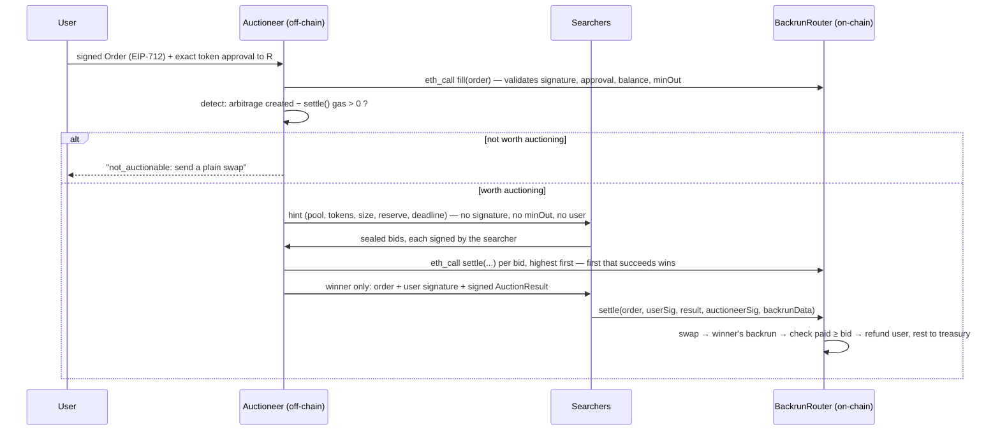
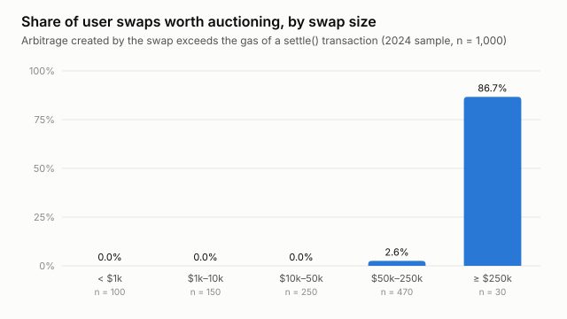
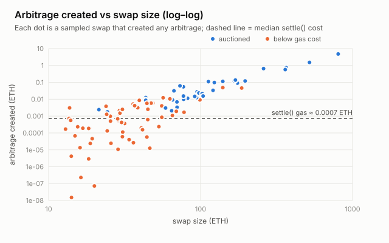
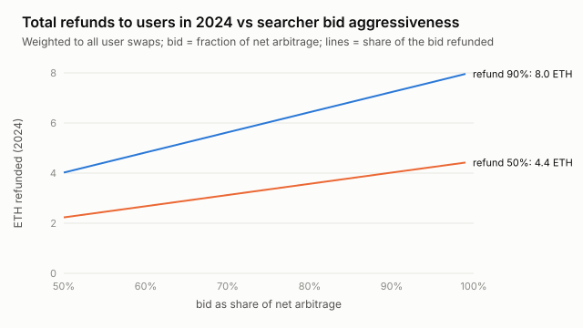
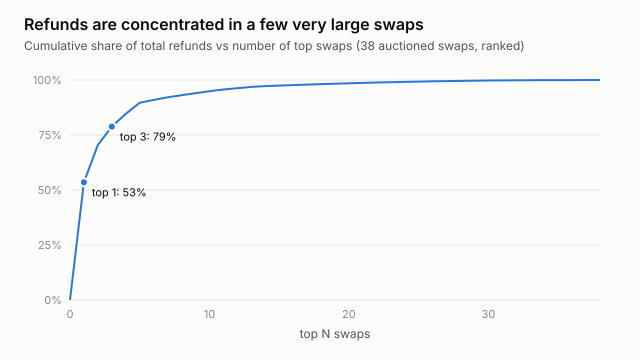
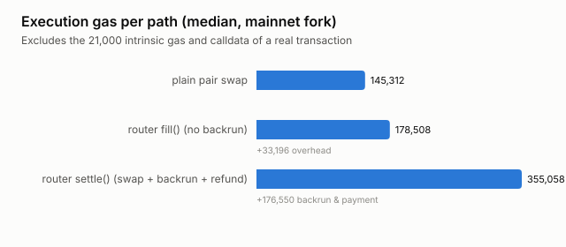

# MEV redistribution via a backrun-refunding DEX router

*Project C3. Design, implementation and evaluation on forked Ethereum mainnet state.*

## Summary

A user's swap on an automated market maker (AMM) moves the pool's price and creates an arbitrage
opportunity. Searchers capture it with a **backrun**, and today the user gets none of that value. This project
builds a router that **detects** when a swap creates such an opportunity, **auctions** the right to
backrun it, and **refunds** a share of the winning payment to the trader. The swap, the backrun,
the payment and the refund all happen in **one transaction**, enforced by the contract.

The mechanism was evaluated by replaying **1,000 historical 2024 user swaps** (Uniswap V2 USDC/WETH)
through the router on forked mainnet state:

| Result | Value |
|---|---|
| Router output vs a plain swap | **identical in 1,000 / 1,000 replays** |
| User swaps whose backrun is worth more than its gas | **3.8% of the sample**; weighted to the year, **≈ 60 of ≈ 703,000 user swaps (0.0085%)**, almost all ≥ $50k |
| Refunds to users, whole of 2024 (bid 90%, refund 90%) | **≈ 7.2 ETH (≈ $23k)**, a lower bound (only the Uniswap V2 ↔ Sushiswap arbitrage) |
| Concentration | the largest single swap carries **53%** of all refunds; the top 3 carry **79%** |
| Router overhead | **+33k gas (+23%)** over a plain pair swap |
| Who pays gas | the **winning searcher** pays all of it, out of the MEV; the user pays none |
| Key design finding | relaying unprofitable orders would cost **≈ 2,823 ETH** of gas in 2024, ~390× the refunds; only predicted-profitable swaps may enter the router |
| End-to-end demo (real 366-WETH swap) | 3 competing bots; winner paid **0.708 ETH**; user refunded **0.637 WETH**, output equal to the quote |

**Conclusion.** The mechanism works and is safe for users: it never worsened execution in 1,000
real replays. But on this venue its value is small and **concentrated in a few very large swaps**.
For almost every retail-sized swap the arbitrage it creates is worth less than the gas of
auctioning it. Incentives are sound for users and searchers (no profitable deviation breaks
payment). The remaining trust sits with the off-chain auctioneer: it picks the winner and keeps
bids sealed, which the on-chain contract cannot check.

---

## 1. Background

* **MEV and backrunning.** Executing a swap of size Δx in a constant-product pool (x·y = k) moves
  that pool's price. If another pool trades the same pair at the old price, an arbitrageur can buy
  where it's cheap and sell where it's dear. Done immediately after the user's swap, in the same
  block, this is a *backrun*. Daian et al. (*Flash Boys 2.0*) documented searchers competing for such
  opportunities through priority-gas auctions and named the phenomenon miner (now maximal)
  extractable value.
* **Where the value goes today.** Searchers compete for ordering, so most of a backrun's profit is
  bid away to block builders and proposers (proposer–builder separation, PBS; see Koegler, *SoK:
  ePBS*). The user who created the opportunity receives nothing.
* **Order-flow auctions.** Flashbots **MEV-Share** lets users share hints about their transaction;
  searchers submit backrun bundles, and the matchmaker and builder pay a share of the searcher's bid
  back to the user (90% by default). The refund is computed and paid **off-chain by trusted
  infrastructure**.
* **This project** moves settlement on-chain. The router itself executes swap + backrun atomically,
  checks that the winner paid, and pays the user's refund. Nobody has to be trusted to pay it.

---

## 2. Design

### 2.1 Architecture



The design is **"signed intent, winner submits"**. The user signs an order instead of a
transaction, so they pay no gas. The winning searcher submits the single transaction that does
everything, so it pays all the gas out of the MEV it captures.

### 2.2 Contracts (`src/`)

**`BackrunRouter.settle(order, userSig, auctionResult, auctioneerSig, backrunData)`**, in order:
1. `block.number ≤ validUntilBlock`; `msg.sender == auctionResult.winner`;
2. consume the order: deadline, single-use nonce, user signature (EIP-712; ERC-1271 wallets
   supported via OpenZeppelin `SignatureChecker`);
3. `auctionResult.orderHash == hashOrder(order)`, and it is signed by the auctioneer;
4. swap the user's tokens in the Uniswap V2 pair; output goes straight to the user and must be
   `≥ minOut` (fee-on-transfer safe: the input is measured as the pair's balance change);
5. call the winner's executor, capping the gas forwarded; then **measure** the router's
   bid-token balance change and require `paid ≥ bid`;
6. pay `refundBps` (90%) of the payment to the user and the rest to the treasury.

Any failure reverts the whole transaction. The user paid no gas and loses nothing; the order can
be re-auctioned.

**`fill(order, userSig)`** is the plain swap path with no backrun. Only the auctioneer (as a
relayer) or the user may call it. If anyone could, a searcher could fill an order and then backrun
it in the next transaction without paying.

**`ReferenceArbExecutor`** is an example searcher. It sizes the two-pool arbitrage **on-chain at
execution time** (closed form below), refuses to run for any auction it didn't win, and pays its bid.

**Optimal arbitrage size.** Chaining two constant-product swaps with fee factor γ = 0.997 gives
`out(dx) = a·dx / (b + c·dx)`, with `a = γ²·x2·y1`, `b = x1·y2`, `c = γ·(y2 + γ·y1)`. Profit
`out(dx) − dx` is concave and is maximised at **dx\* = (√(ab) − b)/c**. This is positive only when
the second pool values Y more highly. The closed form agrees exactly with brute-force search: the
worked example's 0.781513749829168636 ETH matches to the wei in Solidity, in Python and on the fork.

**Security properties, each covered by a test** (15 Solidity tests including fuzzing, all passing):

| Property | Test(s) |
|---|---|
| User gets ≥ `minOut`; output equals the plain V2 quote | `testFuzz_settle_userGetsQuote` (256 runs), `test_replay_*` |
| Refund = 90% of payment; router keeps nothing | `test_settle_swapsBackrunsAndRefunds` |
| Order executes at most once; user can cancel | `test_revert_replay`, `test_userCanCancel` |
| Only the auction winner can settle (no copying from the mempool) | `test_revert_notWinner` |
| Auction result must be fresh and auctioneer-signed | `test_revert_auctionExpired`, `test_revert_fakeAuctioneer` |
| Underpayment reverts everything; user untouched | `test_revert_underpaid`, `test_revert_bidAboveProfit_userUntouched` |
| An executor can't be spent by someone else's auction | `test_revert_executorOwnedBySomeoneElse` |
| No reentrancy through the callback | `test_revert_reentrancy` |

### 2.3 The auction mechanism (`offchain/auctioneer/`)

| Element | Choice | Why |
|---|---|---|
| Format | **sealed-bid, first-price** | The router can check that the winner paid *its own signed* bid. A second price would rely on the auctioneer's unverifiable claim about the runner-up (shill bidding). |
| Eligibility | **simulation-gated**: highest bid first; it wins only if `eth_call settle()` from that searcher succeeds | A searcher can't win with a bid its backrun can't pay. |
| Reserve price | 10% of the estimated net arbitrage | Limits the damage from low-ball bids or collusive bid rings. |
| Bid authentication | each bid is EIP-191-signed by the searcher | Stops anyone submitting a bid in someone else's name and forcing them to "win". |
| Ties | earliest bid | Deterministic. |
| Information | hint = pool, tokens, size, reserve, deadline. Never the user, signature or `minOut`. Full order only to the winner. | Searchers need the size to value the backrun; the rest stays private until it can only be used by the winner. |
| Pre-screen | auction only if `estimated arbitrage − settle() gas > 0` | §5: everything else costs more gas than it can return. |
| Transparency | every bid, reserve, winner and price appended to an audit log | Lets anyone check afterwards that the highest valid bid won. |

**Where the auction runs.** The bids are compared and the winner is chosen **off-chain** by the
auctioneer. Payment, the refund and the user's price protection are enforced **on-chain**, so
the auctioneer can never take funds or shrink a refund. It *could* award a lower bidder; the signed
bids and the audit log make that detectable after the fact but not impossible (§6.3). Choosing the
winner on-chain is discussed as future work in §8.

### 2.4 Service and bots

* `offchain/auctioneer/service.py`: HTTP API (`POST /orders`, `GET /hints`, `POST /bids`,
  `GET /results/<id>`, `GET /orders/<id>`) and the order lifecycle (validate → detect → auction →
  award → audit).
* `offchain/searcher/bot.py`: watches hints, values the backrun (profit − own gas), bids a
  configurable fraction of that value, and submits `settle()` if it wins.
* Chain access uses Foundry's `cast` (no third-party Python packages). EIP-712 digests come from the
  router's own `hashOrder`/`hashAuctionResult`, so off-chain and on-chain hashing cannot diverge.
* 8 unit tests run the service against a fake chain: highest valid bid wins; a higher bid that fails
  simulation is skipped; forged bids are rejected; only the winner receives the order; hints leak no
  user data; reserve and late-bid handling; pre-screen under normal and extreme gas prices; invalid
  orders.

---

## 3. Evaluation methodology

**Data.** Every `Swap` event of the Uniswap V2 USDC/WETH pair in calendar 2024 (blocks
18,900,000–21,499,999): **887,703 swaps**, collected through an archive RPC (dRPC, 100-block log
queries).

**User swaps only.** Pool events include arbitrage bots, often the very backruns being measured.
A swap counts as a *user* swap only if its transaction was sent to a known user-facing router or
aggregator: Uniswap Router02 and Universal Routers, 1inch v5/v6, 0x, MetaMask Swaps, ParaSwap v5/v6,
KyberSwap.

**Stratified sample with weights.** 64% of swaps are under $1k and create no arbitrage, so a uniform
sample would mostly measure zeros. Swaps were stratified by USD size, with quotas weighted toward
large swaps. Each sampled swap carries a weight: the estimated number of 2024 user swaps it
represents. Totals are weighted sums, so oversampling large swaps doesn't bias them.

| Size | 2024 swaps | Share to user routers | Est. user swaps | Sampled | Weight |
|---|---|---|---|---|---|
| < $1k | 564,026 | 84% | 470,962 | 100 | 4,709.6 |
| $1k–10k | 256,848 | 82% | 210,615 | 150 | 1,404.1 |
| $10k–50k | 60,169 | 34% | 20,509 | 250 | 82.0 |
| $50k–250k | 6,303 | 21% | 1,314 | 470 | 2.8 |
| ≥ $250k | 354 | 8% | 30 | 30 (all) | 1.0 |

Large swaps are mostly *not* sent to user routers: 92% of ≥ $250k swaps went to other contracts
(bots and aggregators outside the list). The ≥ $250k bucket had only 30 user swaps, so all were
taken and its unused quota moved to $50k–250k.

**Counterfactual replay** (`test/replay/ReplayHarness.sol`, `test/fork/SettleReplay.t.sol`):
1. Fork mainnet at the end of block *N − 1*. Re-execute the earlier transactions of block *N* that
   touched either pool (from their logs). Set block *N*'s number and base fee. The pools' state is
   then exactly what the historical trader faced.
2. Instead of the historical transaction, a test user makes the same swap (pool, direction,
   amount), four ways from the same state, rolling back after each:
   plain pair swap → `router.fill` → `router.settle` with bid 0 (measures the profit) →
   `router.settle` with bid = 90% of the profit (measures gas and refund).
3. Gas is execution gas measured around each call, with every touched account reset to cold first
   (`vm.cool`). Intrinsic (21,000) and calldata (12,000, estimated) gas are added in the analysis.
4. Only arbitrage **created** by the swap counts (profit after the swap minus any that existed
   before it).

**Economic assumptions.**
- Gas price = the block's actual base fee + a 1 gwei tip. The sample's median is 18.9 gwei and its
  maximum 644 gwei.
- The bid is a fraction of the net arbitrage: 90% in the headline numbers, with 50–99% shown in the
  sensitivity analysis.
- The refund share is 90%, with 50% shown for comparison.
- USD values use the pool's own price at each swap ($2,158–$4,077 across the sample).

---

## 4. Results

### 4.1 Correctness on real state
All 1,000 replays completed. **The router's output equalled the plain swap's output in every one**:
routing through it never cost the user anything in price.

### 4.2 Which swaps are worth auctioning



| Size | n | Worth auctioning | Median refund (ETH) | Mean refund (ETH) |
|---|---|---|---|---|
| < $1k | 100 | 0.0% | 0 | 0 |
| $1k–10k | 150 | 0.0% | 0 | 0 |
| $10k–50k | 250 | 0.0% | 0 | 0 |
| $50k–250k | 470 | 2.6% | 0 | 0.000058 |
| ≥ $250k | 30 | **86.7%** | **0.0176** | **0.2387** |

99 of the 1,000 sampled swaps created *some* arbitrage, but only 38 created more than the gas of a
settle transaction (median cost 0.0056 ETH). The smallest swap worth auctioning was 21.4 ETH.
Weighted to the year, that is about 60 of ~703,000 user swaps (0.0085%).



The arbitrage created grows faster than linearly with size: price impact, and so the mispricing,
grows with Δx/x. Swaps below roughly 20–50 ETH sit under the gas line. Some orange dots lie above
the median-gas line because they happened when gas was more expensive than the median.

### 4.3 Refund value

Weighted to all ≈ 703,000 user swaps of 2024 on this pool:

| Bid (share of net arbitrage) | Refund share 50% | Refund share 90% |
|---|---|---|
| 50% | 2.22 ETH ($7.1k) | 3.99 ETH ($12.8k) |
| 80% | 3.55 ETH ($11.4k) | 6.39 ETH ($20.5k) |
| **90%** | 3.99 ETH ($12.8k) | **7.19 ETH ($23.1k)**; weighted per bucket: **7.24 ETH ($23.2k)** |
| 99% | 4.39 ETH ($14.1k) | 7.91 ETH ($25.4k) |

(The sensitivity rows use sample sums. Weighting changes them by under 1% because nearly all
refunds come from the ≥ $250k bucket, whose weight is 1.)



For an auctioned swap (bid 90%, refund 90%):
- the median refund is **50% of the arbitrage the swap created**; the rest goes to gas and the
  searcher's margin;
- that is **0.014% of the swap's size**;
- the user's median benefit over a plain swap is **0.0143 ETH**: the refund plus the gas of their
  own swap, which the searcher now pays.

### 4.4 Concentration



One swap carries 53% of all refunds: 804.5 ETH in block 19,468,620, creating 4.80 ETH of
arbitrage. The top three carry 79%. Refund value is a property of rare whale trades, not of typical
order flow.

### 4.5 End-to-end run of the full system

`offchain/demo/run_demo.py` runs everything on a fork at block 20,114,509, replaying the historical
**366.17 WETH → USDC** sale of block 20,114,510:
1. deploys the router and three executors;
2. starts the auctioneer service and three searcher bots as separate processes; the bots bid 50%,
   80% and 95% of their estimated value;
3. submits the user's signed order.

| | Value |
|---|---|
| Auctioneer's estimate of net arbitrage | 0.7456 ETH (backtest: 0.7440) |
| Reserve | 0.0746 ETH |
| Bids (alice 50%, bob 80%, carol 95%) | 0.3728 / 0.5965 / **0.7083** ETH |
| Winner and price | carol, 0.7083 ETH (first price) |
| User output | 1,254,393.62 USDC, **exactly** the quote |
| User refund | **0.6375 WETH** (90%) |
| Treasury | 0.0708 WETH (10%) |
| settle() transaction | 326,207 gas, paid by carol |
| Second order, 1 WETH | rejected by the pre-screen: arbitrage 0.0000019 ETH < gas 0.00081 ETH |

---

## 5. Who bears the gas?



| Path | Median execution gas |
|---|---|
| Plain pair swap | 145,312 |
| Router `fill()` (no backrun) | 178,508: **+33,148 (+23%)** router overhead (user-signature check, nonce write, pool validation, balance checks) |
| Router `settle()` (swap + backrun + refund) | 355,058: **+175,428** for the auctioneer-signature check, the backrun, the payment check and two refund transfers |

**Incidence, by path.**

1. **Auctioned swaps:** the searcher submits `settle()` and pays all of it: swap, overhead,
   backrun and refunds. A rational searcher folds that into its bid (`bid ≤ arbitrage − gas`), so
   **economically the gas comes out of the MEV**, i.e. out of what would otherwise be refunded.
   The user pays **no gas** and saves the gas of their own swap.
2. **Swaps not worth auctioning:** the router only adds overhead (+33k gas) and returns nothing.
   If the user sends them through the router themselves, they are **worse off** than with a plain
   swap. If the auctioneer relays them via `fill()`, the auctioneer pays. Weighted to 2024, relaying
   every non-auctioned user swap would have cost **≈ 2,823 ETH (≈ $9.2M)** of gas, about **390×**
   the refunds generated.
3. **Therefore** the pre-screen carries the economics: an order enters the router only if its
   predicted arbitrage exceeds the settle gas. Otherwise the user is told to swap directly. The
   service does this by default; relaying `fill()` is opt-in (`--relay-fill`).

**Break-even.** At the sample's median gas price an auction pays only if the swap creates more than
~0.0056 ETH of arbitrage, which needs swaps of roughly ≥ 20–50 ETH on this pool. Higher gas prices
push the threshold up; the service test `test_high_gas_blocks_auction` shows a 0.78-ETH opportunity
becoming un-auctionable at 10,000 gwei.

**Calibration against a real receipt.** The demo's real `settle()` transaction used **326,207 gas**,
*less* than the harness's 360,744 execution gas for the same swap. A real transaction receives
storage refunds (the router's WETH balance goes 0 → bid → 0) and has its sender and target pre-warmed,
so the backtest's gas (execution + 21k + 12k) is **conservative**. Re-running the analysis with
gas calibrated to the receipt (×0.904) raises the auctioned swaps from 38 to 40 and refunds from
7.24 to 7.34 ETH (+1.4%). The headline numbers use the conservative value.

---

## 6. Is the mechanism incentive-compatible?

"Incentive-compatible" is used here in two senses: (a) no participant can profit by deviating in a
way that breaks the mechanism (payment, refund, user price protection); (b) whether bidding is
*truthful*. (a) holds by construction; (b) does not, by design, and that is acceptable.

### 6.1 Searchers
* **Bid shading.** In a first-price sealed-bid auction the dominant strategy is *not* to bid one's
  value. Searchers shade. The demo shows this directly: three bots valuing the backrun at
  0.7456 ETH bid 50%, 80% and 95% of it. The arbitrage is close to **common value** (anyone sees the
  same pools), so with competition bids are driven toward value minus cost, much like price
  competition between identical sellers. The backtest's sensitivity table covers bids from 50% to 99%.
* **Why not second-price?** A Vickrey auction makes truthful bidding dominant, but only if the
  auctioneer honestly reports the second price. The router only sees what the auctioneer signs, so it
  could not verify the runner-up and the auctioneer could inflate the price with a fake bid. A
  verifiable first price is preferred over an unverifiable truthful mechanism.
* **Overbidding / non-payment.** A searcher cannot win with a bid it can't pay: simulation gates
  eligibility, and on-chain `paid ≥ bid` reverts otherwise. Winning and then not submitting
  (griefing) costs the user only time. The result expires after `validUntilBlock` and the order can
  be re-auctioned. Bonds or reputation would raise the cost of repeated griefing (future work).
* **Impersonation and theft.** Bids are signed by their searcher, so no one can bid in another's
  name. An executor refuses to run for an auction its owner didn't win, so inventory can't be drained
  through it.
* **Collusion.** A bid ring could bid low and split the surplus. The reserve price (10% of the
  estimated value) bounds the loss to users; it cannot be eliminated with few bidders.
* **Outside option.** A searcher cannot backrun an order outside the auction: the order is private,
  and only the winner can execute it (`msg.sender == winner`). It can only arbitrage what the winner
  leaves behind, so winners are incentivised to close the price gap fully, which the reference
  executor does.

### 6.2 Users
* **Price.** The router's output equalled a plain swap's in 1,000/1,000 replays, and `minOut` is
  enforced on-chain. A user is never worse off on price.
* **Participation.** When auctioned, a user gains the refund plus the gas of their own swap. When the
  order is not auctionable, the service tells them to swap directly, so they lose nothing. The real
  costs are latency (the auction window plus inclusion) and information: the hint reveals size and
  direction to searchers.
* **Gaming.** Can a user make money by trading only to collect refunds? No:
  `refund ≤ r · bid ≤ r · arbitrage ≤ the user's own price impact`, and a round trip also pays the
  pool's 0.3% fee twice. Any manufactured swap loses more to price impact and fees than it earns
  back. A user bidding on their own order is harmless: it is equivalent to capturing their own MEV.

### 6.3 Auctioneer
* **Cannot:** take funds, change the refund share, execute a different order than the user signed,
  or worsen the user's price. All of that is enforced on-chain.
* **Can (trusted for):**
  - awarding a lower bid than the highest;
  - leaking bids to a favoured searcher;
  - front-running users with order-flow information;
  - censoring or delaying orders.
* **Mitigations:**
  - every bid carries its searcher's signature and is appended to an audit log, so a skipped higher
    bid is provable after the fact by the searcher who made it;
  - several competing auctioneers;
  - running the auctioneer in a trusted execution environment;
  - choosing the winner on-chain (§8).

  This is the same trust that MEV-Share places in its matchmaker, minus the refund: here the refund
  is trustless.

### 6.4 Builders and validators
* **Reordering.** The swap and backrun are one transaction, so nothing can be inserted between them.
* **Sandwiching the whole transaction.** It is bounded by the user's `minOut`. The winner should
  submit privately (Flashbots Protect or a builder bundle) and users should set tight slippage.
* **Censorship.** A builder can drop the transaction; the result then expires (`validUntilBlock`) and
  the order is re-auctioned or falls back. Under PBS the relay is a trusted party (Koegler's SoK),
  and enshrined PBS would remove that relay trust but not builder discretion.
* **Incentive to include.** The settle transaction pays an ordinary priority fee. What builders lose
  is the backrun value they would otherwise capture through searcher bids, which is now partly
  redirected to users. Builders favouring bundles that pay them more is the main adoption risk for
  any order-flow auction.

### 6.5 Liquidity providers
LPs are unaffected relative to today. The arbitrage happens either way and the loss-versus-rebalancing
it represents is still paid by LPs. The mechanism only changes **who** receives the arbitrage profit:
users rather than searchers and builders.

**Overall.** No participant can break payment, the refund or the user's price protection. Bidding is
strategic (shaded), not truthful. The residual trust is concentrated in the auctioneer's choice of
winner and its handling of information.

---

## 7. Comparison with MEV-Share

| | MEV-Share | This router |
|---|---|---|
| What is auctioned | backrun bundles referencing the user's transaction | the right to call `settle()` for a signed order |
| Refund computed and paid by | the builder, off-chain (simulates the bundle without the user's transaction) | **the contract**, inside the user's transaction |
| User pays gas | yes (their own transaction) | **no**; the winner pays everything |
| User price protection | the user's own slippage limit | `minOut` enforced by the router |
| Winner chosen by | builders / matchmaker | the auctioneer (off-chain) |
| Trust | matchmaker and builder (selection *and* payment) | auctioneer (selection only) |

---

## 8. Limitations and future work

**Limitations (threats to validity):**
* **This is a lower bound on MEV.** Only the Uniswap V2 ↔ Sushiswap cycle is measured. Real
  searchers also use Uniswap V3 (most of the liquidity), multi-hop routes and centralised exchanges,
  and would bid more.
* **One pool, one year.** Uniswap V2 USDC/WETH in 2024. Other pairs and periods will differ.
* **Bid model.** The bid fraction is assumed (50–99%), not calibrated from what searchers actually
  paid builders for these backruns.
* **User filter.** "User swap" = sent to one of ten known routers. Aggregators outside the list
  (CoW, 1inch Fusion, Odos…) are counted as non-users, so the large-swap population is understated.
* **Counterfactual.** Each swap is replayed in isolation: no other searcher reacts, and later
  transactions in the block are ignored.
* **Demo fork.** The end-to-end demo forks at the end of the previous block without re-executing
  earlier same-block transactions; the backtest does re-execute those that touch the pools.
* **Calldata gas** is estimated (12k); the real receipt shows the overall estimate is conservative.

**Future work:**
* **Choose the winner on-chain.** Searchers sign bids; `settle(order, sig, Bid[])` verifies all of
  them, picks the highest, falls back to the next on failure, and can then charge a *verifiable*
  second price. The auctioneer is reduced to collecting bids (it could only censor).
* Uniswap V3 and multi-hop arbitrage; a flash-swap executor that needs no inventory.
* Calibrate the bid fraction from real backruns (their coinbase payment ÷ profit).
* Bonds or reputation against griefing; Permit2 instead of `approve`; multiple auctioneers.

---

## 9. Reproducing the results

```bash
forge test                                                   # 15 Solidity tests (fork test skipped)
python -m unittest discover -s offchain/tests -t .           # 15 Python tests
python backtest/collect_swaps.py --from-block 18900000 --to-block 21499999 --threads 16 --out backtest/data/swaps_2024.csv
python backtest/sample_swaps.py --swaps backtest/data/swaps_2024.csv --n 1000 --out backtest/data/sample_1000.csv
python backtest/run_fork_replays.py --swaps backtest/data/sample_1000.csv --limit 1000 --workers 8
python backtest/analyze.py --sample backtest/data/sample_1000.csv --rows-out backtest/results/rows.csv
python backtest/plots.py
python -m offchain.demo.run_demo                             # end-to-end system on a fork
```

`ETH_RPC_URL` (an archive node) is read from `.env`. With a free dRPC key: collection ≈ 23 min,
sampling ≈ 3 min, replays ≈ 35 min (8 workers), demo ≈ 5–10 min.

## References
* Flashbots, *MEV-Share documentation*. https://docs.flashbots.net/flashbots-mev-share/introduction
* M. Koegler, *SoK: Current State of Ethereum's Enshrined Proposer Builder Separation*, arXiv:2506.18189.
* P. Daian et al., *Flash Boys 2.0: Frontrunning, Transaction Reordering, and Consensus Instability in Decentralized Exchanges*, IEEE S&P 2020, arXiv:1904.05234.
* A. Antonopoulos, G. Wood et al., *Mastering Ethereum*, 2nd ed.
